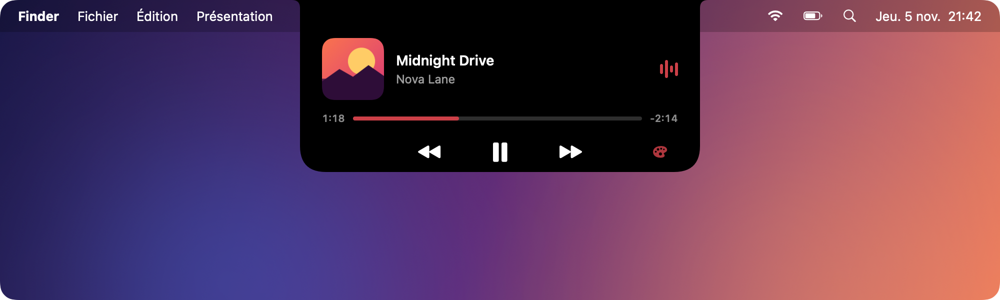
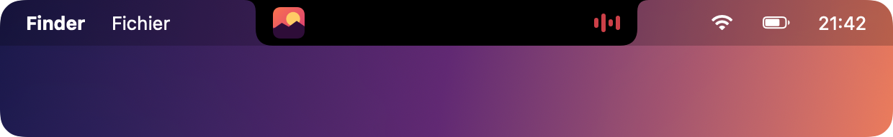
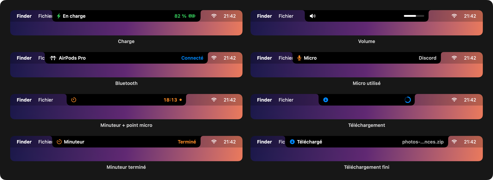
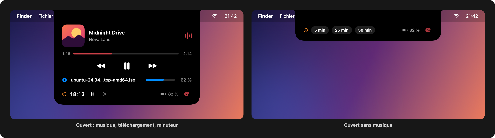
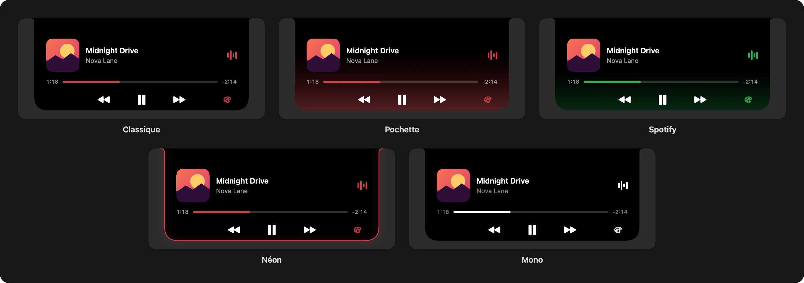

# DynamicNotch

[English](README.md) | Français

Le Dynamic Island de l'iPhone, mais sur l'encoche du MacBook. Spotify, la charge, un minuteur, le volume, les téléchargements, le Bluetooth et le micro / la caméra, juste autour de la caméra.



Quand un son passe, l'encoche s'élargit un peu : la pochette à gauche de la caméra, un petit égaliseur à droite. Tu passes la souris dessus et ça s'ouvre avec le titre, l'artiste, la barre de progression et les boutons.



## Ce que ça affiche



- **Spotify** : pochette et égaliseur, mini lecteur au survol
- **Charge** : quand tu branches le chargeur, l'encoche affiche le niveau de batterie deux secondes, comme sur l'iPhone
- **Minuteur** : survole l'encoche et choisis 5, 25 ou 50 min. Le temps restant reste à côté de la caméra et l'île vibre à la fin
- **Micro et caméra** : un point orange (micro) ou vert (caméra) tant que quelque chose enregistre, avec le nom de l'app qui utilise le micro
- **Volume** : une petite barre quand tu changes le volume
- **Téléchargements** : la progression de ce qui se télécharge dans Chrome, Brave, Edge, Safari ou Firefox, et une notif quand c'est fini
- **Bluetooth** : AirPods, casques, claviers et souris quand ils se connectent



## Prérequis

- macOS 14 ou plus récent (14.2 pour voir quelle app utilise le micro)
- Un Mac avec encoche (sur les autres, ça fait une petite pilule dans la barre des menus)
- Spotify (l'app desktop) pour la partie musique
- Les outils de ligne de commande Xcode pour compiler : `xcode-select --install`

## Télécharger

Prends `DynamicNotch.zip` dans la [dernière release](https://github.com/MrJ23-pro/DynamicNotch/releases/latest), dézippe et glisse `DynamicNotch.app` dans Applications. Mac Apple Silicon uniquement.

L'app n'est pas notarisée, donc macOS la bloque au premier lancement. Soit tu vas dans Réglages Système > Confidentialité et sécurité et tu cliques sur "Ouvrir quand même", soit tu lances :

```bash
xattr -dr com.apple.quarantine /Applications/DynamicNotch.app
```

## Compiler soi-même

```bash
git clone https://github.com/MrJ23-pro/DynamicNotch.git
cd DynamicNotch
./build.sh
open DynamicNotch.app
```

Au premier lancement macOS demande quelques autorisations :

- **Spotify (Automatisation)** : pour lire le son en cours et utiliser les boutons
- **Bluetooth** : pour voir les appareils qui se connectent
- **Dossier Téléchargements** : pour suivre les téléchargements en cours

Si tu en refuses une, seule la fonction concernée est désactivée. Tu peux changer ça plus tard dans Réglages Système > Confidentialité et sécurité.

Pour qu'il se lance au démarrage, glisse `DynamicNotch.app` dans Applications puis ajoute-le dans Réglages Système > Général > Ouverture.

## Utilisation

- Survoler l'encoche pour l'ouvrir, même sans musique (c'est là qu'est le minuteur)
- Cliquer sur la barre de progression pour avancer dans le son
- Le bouton palette change de thème
- Clic droit sur l'île pour choisir un thème ou quitter

Thèmes dispo : Classique, Pochette, Spotify, Néon, Mono. Le choix est gardé entre deux lancements.



## Comment ça marche

Tout fonctionne par événements, rien ne tourne en boucle quand il ne se passe rien :

- Spotify envoie une notification système à chaque changement de son ou de lecture. AppleScript sert seulement pour la pochette et les boutons, hors du thread principal
- La batterie passe par les notifications d'alimentation d'IOKit
- Le volume et le micro passent par des écouteurs Core Audio, la caméra par Core Media IO
- Les téléchargements : l'app surveille le dossier pour les fichiers `.crdownload`, `.download` et `.part`, et lit la progression que les navigateurs écrivent dans l'attribut `com.apple.progress.fractionCompleted`. Un rafraîchissement toutes les secondes tourne seulement pendant un téléchargement
- Le Bluetooth passe par les notifications de connexion d'IOBluetooth

Quand il n'y a rien à afficher, la fenêtre est retirée de l'écran. Du coup l'app est à 0 % de CPU au repos, pour 20 à 25 Mo de mémoire.

## Limites

- Musique : Spotify uniquement pour l'instant (pas Apple Music)
- Le carré de volume de macOS s'affiche quand même à côté de l'île
- Aucune API publique ne dit quelle app utilise la caméra, donc ça affiche juste "Caméra"
- Sur plusieurs écrans, l'île reste sur l'écran qui a l'encoche
- Pas notarisée, voir [Télécharger](#télécharger) pour passer Gatekeeper

## Licence

MIT, voir [LICENSE](LICENSE).
