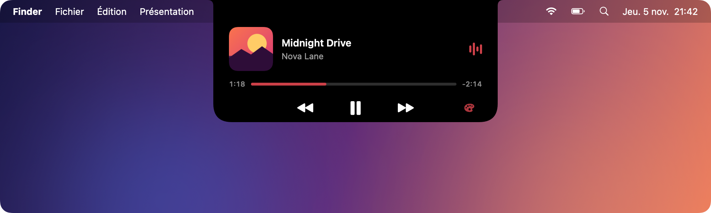
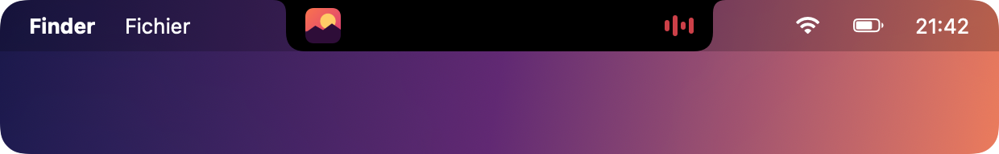
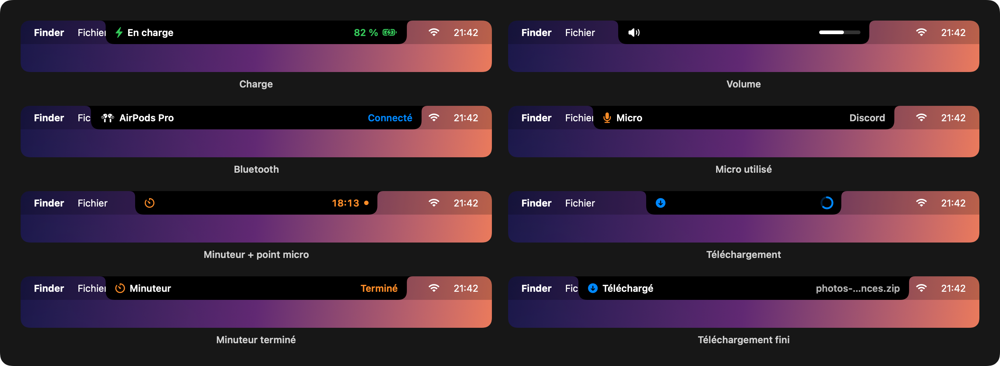
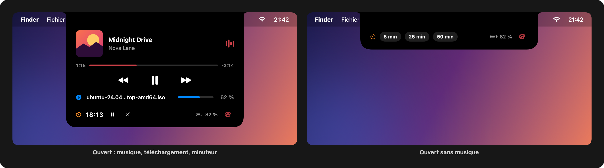
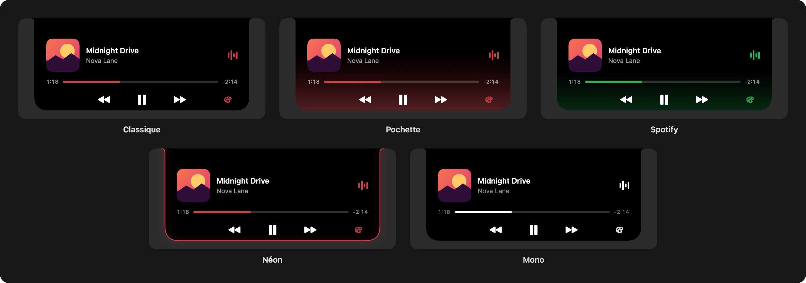

# DynamicNotch

English | [Français](README.fr.md)

A Dynamic Island for the MacBook notch. Spotify, charging, a timer, volume, downloads, Bluetooth and mic / camera use, right around the camera.



When a song is playing, the notch gets a bit wider: album art on the left of the camera, a small equalizer on the right. Hover it and it expands with the title, artist, a progress bar and the playback controls.



It's a free, open source take on what apps like NotchNook or Alcove do, kept as light as possible.

## What it shows



- **Spotify**: album art and equalizer, mini player on hover
- **Charging**: plug the charger in and the notch shows the battery level for a couple of seconds, like on the iPhone
- **Timer**: hover the notch and pick 5, 25 or 50 min. The time left stays next to the camera and the island shakes when it's done
- **Mic and camera**: an orange (mic) or green (camera) dot while something records, and the name of the app using the mic
- **Volume**: a small bar when you change the volume
- **Downloads**: progress of what's downloading in Chrome, Brave, Edge, Safari or Firefox, and a note when it's done
- **Bluetooth**: AirPods, headphones, keyboards and mice when they connect



## Requirements

- macOS 14 or later (14.2 to see which app uses the mic)
- A Mac with a notch (on other Macs it shows as a small pill in the menu bar)
- The Spotify desktop app for the music part
- Xcode command line tools to build it: `xcode-select --install`

## Download

Grab `DynamicNotch.zip` from the [latest release](https://github.com/MrJ23-pro/DynamicNotch/releases/latest), unzip it and move `DynamicNotch.app` to Applications. Apple Silicon only.

The app isn't notarized, so macOS will block it the first time. Either go to System Settings > Privacy & Security and click "Open Anyway", or run:

```bash
xattr -dr com.apple.quarantine /Applications/DynamicNotch.app
```

## Build from source

```bash
git clone https://github.com/MrJ23-pro/DynamicNotch.git
cd DynamicNotch
./build.sh
open DynamicNotch.app
```

On first launch macOS asks for a few permissions:

- **Spotify (Automation)**: to read the current track and use the buttons
- **Bluetooth**: to notice devices connecting
- **Downloads folder**: to follow downloads in progress
- **Accessibility**: to see where the active app's menus end. When they run up to the notch (Brave, Xcode...), the island moves to the right of the notch instead of covering them

Each one only turns off its own feature if you say no. You can change them later in System Settings > Privacy & Security.

To start it at login, move `DynamicNotch.app` to Applications and add it in System Settings > General > Login Items.

## Usage

- Hover the notch to expand it, even when nothing is playing (that's where the timer is)
- Click the progress bar to seek
- The palette button switches theme
- Right click the island to pick a theme or quit

Themes: Classique, Pochette (gradient from the album art color), Spotify, Néon, Mono. Your choice is remembered.



## How it works

Everything is event driven, nothing polls while idle:

- Spotify posts a system notification when the track or playback changes. AppleScript is only used for the album art and the buttons, off the main thread
- Battery comes from IOKit power source notifications
- Volume and mic use Core Audio property listeners, the camera uses Core Media IO
- Downloads watch the folder for `.crdownload`, `.download` and `.part` files and read the progress browsers write in the `com.apple.progress.fractionCompleted` attribute. A 1 s refresh only runs while something is downloading
- Bluetooth uses IOBluetooth connect notifications
- When you switch apps, the Accessibility API gives the position of its menus, read once per switch

When there's nothing to show the window is taken off screen. Result: 0% CPU when idle, around 20 to 25 MB of memory.

## Limitations

- Music is Spotify only for now (no Apple Music)
- The macOS volume overlay still shows up next to the island
- No public API tells which app uses the camera, so it just says "Caméra"
- With several displays, the island stays on the one with the notch
- Not notarized, see [Download](#download) to get past Gatekeeper

## License

MIT, see [LICENSE](LICENSE).
